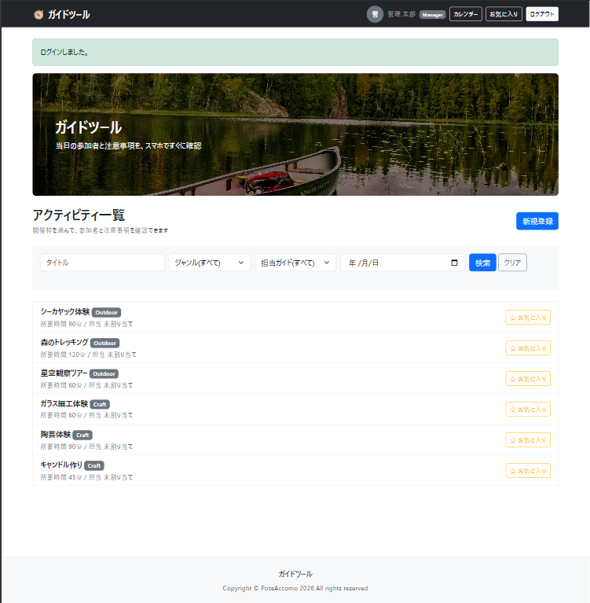
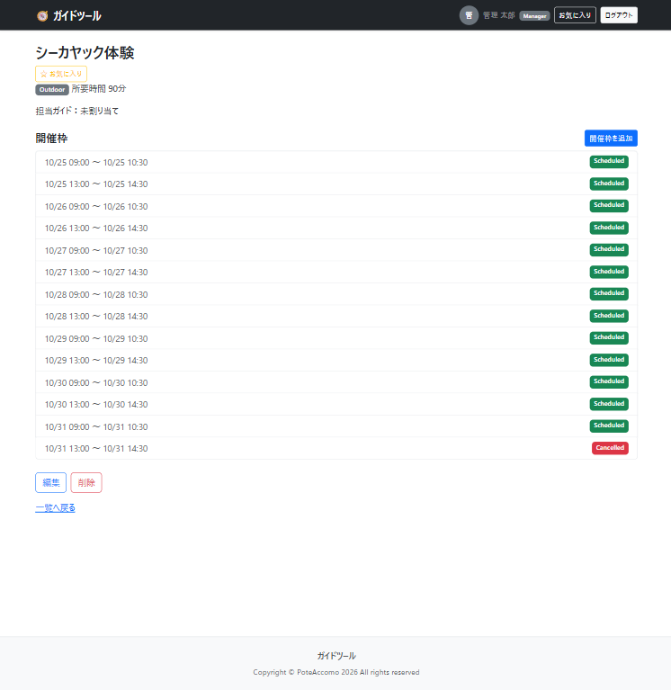
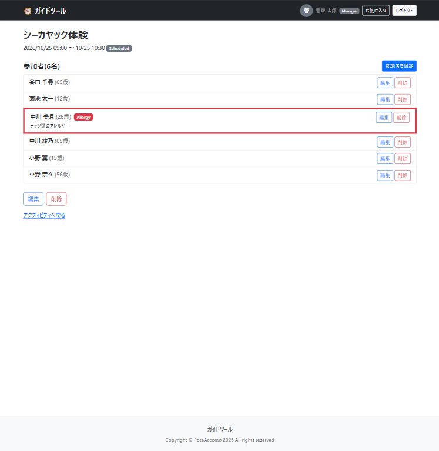
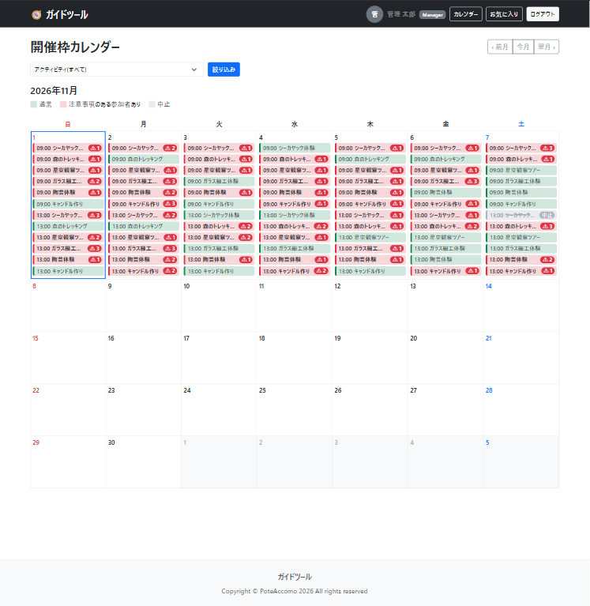
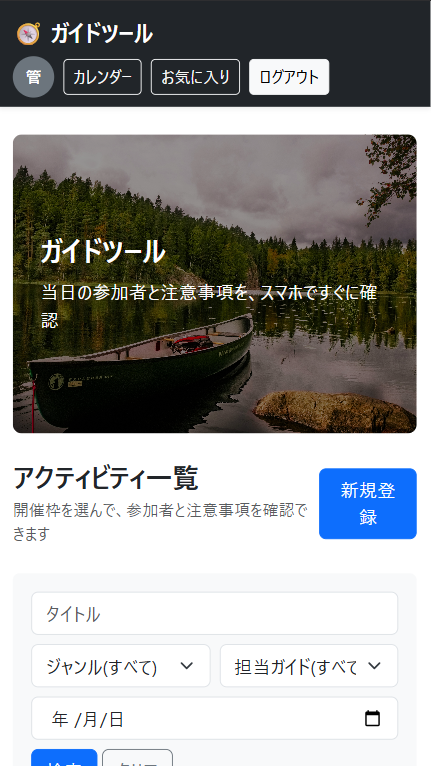
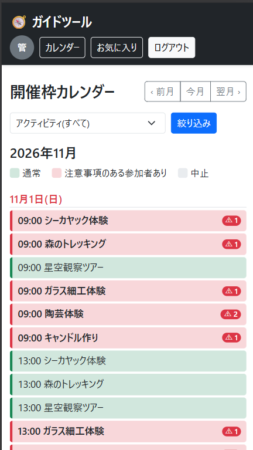
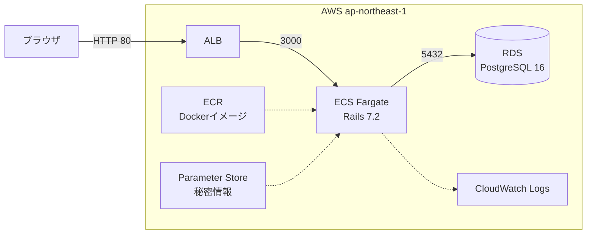
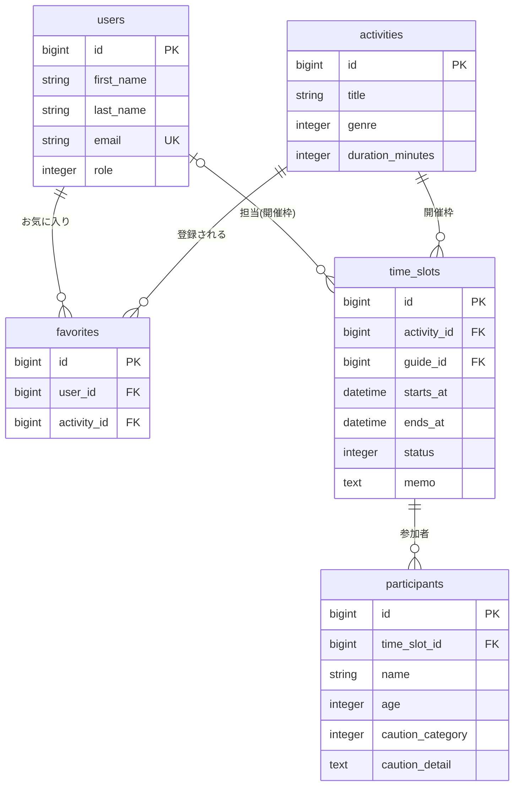

# ガイドツール

リゾート施設のアクティビティガイド向けに、**当日の参加者情報と注意事項(アレルギー・持病など)をスマホで確認できる**現場支援ツールです。

🔗 **URL**: http://myapp-alb-2057278640.ap-northeast-1.elb.amazonaws.com

> ⚠️ 現在はHTTPのみでの公開です（独自ドメインを使用していないため）。ブラウザが自動で `https://` に切り替える場合は、`http://` で開き直してください。**本物のメールアドレスやパスワードは入力しないでください。** デモ用アカウントのみをご利用ください。
>
> 公開期間：2027年1月頃まで（予定）。公開終了後も、このREADMEのスクリーンショットでご確認いただけます。

## デモ用アカウント

実在の個人情報は一切使用していません。すべて Faker と固定文言で作成したダミーデータです。

| 権限 | メールアドレス | パスワード | できること |
|---|---|---|---|
| ガイド | guide@example.com | password | 閲覧、お気に入り、「自分の担当」ページ |
| 管理者 | manager@example.com | メッセージで共有 | 登録・編集・削除 |

## 制作背景

現職でアクティビティの受付・ガイドをしており、参加者のアレルギーや持病などの注意事項を**紙の名簿**でガイドに共有していました。

- 直前の変更が、すでに印刷した紙に反映されない
- 屋外で紙が濡れたり、風で飛んだりする
- 個人情報を紙で持ち歩くリスクがある

予約システムは世の中に多くありますが、「予約を取った後、当日の現場で情報をガイドへ確実に届ける」部分は紙や口頭に頼りがちでした。そこで、スマホで最新の名簿と注意事項を確認できるサービスを作りました。

## 主な機能

- ユーザー登録・ログイン(Devise)
- 権限管理(管理者:登録・編集・削除 / ガイド:閲覧のみ)
- アクティビティ・開催枠・参加者の CRUD
- 注意事項のある参加者を、名簿上でバッジと左線で強調表示
- 開催枠の終了時刻を、アクティビティの所要時間から自動計算
- 検索(タイトル・ジャンル・開催日)とページネーション
- お気に入り(Turbo による画面遷移なしの切り替え)
- スマホ対応のレスポンシブデザイン
- 開催枠ごとの担当ガイドの割り当てと、自分の担当枠だけを表示する「自分の担当」ページ
- 開催枠のカレンダー表示(注意事項ありの枠を色分け)

| ホーム | アクティビティの開催枠一覧 | 開催枠の詳細 | カレンダー表示 | スマホホーム表示 | スマホカレンダー表示 |
|---|---|---|---|---|---|
|  |  |  |  |  |  |

## 工夫した点

- **1行を1人にした参加者テーブル**:注意事項を1人ごとに持たせ、「誰が何に注意が必要か」を明確にしました
- **権限チェックをサーバー側で実施**:登録・編集・削除は、ボタンの表示を切り替えるだけでなく、URL の直打ちでも、管理者以外は弾かれます
- **Ransack の許可リスト**:検索できるカラムと関連を、モデルで明示的に許可しています
- **お気に入りの重複防止**:モデルのバリデーションと DB のユニーク制約の両方で防いでいます
- **テストと CI**:モデル・権限のテストを RSpec で書き、GitHub Actions で rubocop・brakeman・RSpec を自動実行しています
- **本番環境のセキュリティ**:ALB → ECS → RDS の順に、セキュリティグループで必要な通信だけを許可しています。RDS はインターネットに公開せず、ECS からのみ接続できます
- **秘密情報の管理**:`RAILS_MASTER_KEY` や `DATABASE_URL` はコードに含めず、Parameter Store から実行時に注入しています
- **再起動しても壊れない seeds**:本番ではデータが空のときだけデモデータを投入し、タスクが再起動しても重複や消去が起きないようにしています
- **ヘルスチェック**:Rails 標準の `/up` を使い、ALB が異常なタスクを自動で切り離します
- **自動デプロイ**:CI が成功した `main` からだけ、ECR への push と ECS の更新を自動化。AWS の認証は OIDC で、長期のアクセスキーを持たない

## 使用技術

| 分類 | 技術 |
|---|---|
| 言語・FW | Ruby 4.0 / Ruby on Rails 7.2 |
| DB | SQLite(開発)/ PostgreSQL(本番) |
| フロント | Bootstrap 5 / Hotwire(Turbo, Stimulus) |
| 主な gem | Devise / Ransack / Kaminari / Bullet |
| テスト | RSpec / FactoryBot / shoulda-matchers |
| CI/CD | GitHub Actions(CI、ECS への自動デプロイ) |
| インフラ | AWS（ECS Fargate / ECR / RDS for PostgreSQL / ALB / Systems Manager Parameter Store / CloudWatch Logs）、Docker |

## インフラ構成



## ER図



## デプロイ

`main` へのマージ後、CI(rubocop・brakeman・RSpec)が成功すると、GitHub Actions が、Docker イメージをビルドして ECR に push し、ECS Fargate のサービスを更新します。

- AWS への認証は、アクセスキーを保存せず、OIDC で一時的な権限を受け取る方式
- 権限は、このリポジトリの `main` ブランチ、必要な ECR・ECS の操作だけに限定
- マイグレーションは、コンテナ起動時の `db:prepare` で自動実行

## ローカルでの起動方法

```bash
git clone https://github.com/kame-888/activity_guidetool_app.git
cd activity_guidetool_app
bundle install
rails db:setup
rails s
```

`http://localhost:3000` を開き、デモ用アカウントでログインします。

## テストの実行

```bash
bundle exec rspec
```

## 今後の改善案

- 担当外の開催枠の詳細(参加者の注意事項)の閲覧制限(現在は、URLを直接開くと閲覧できる)
- 同じガイドの時間が重なる枠への割り当て警告
- 注意事項を複数登録できるようにする(`cautions` テーブルの分離)
- 天候による催行判断の記録
- 参加者の一括登録フォームの改善
- Rails のバージョンアップ
- 独自ドメインと HTTPS 化(ACM + ALB)
- Terraform によるインフラのコード化

## 画像

トップ画像:Saikrishna Saketh Yellapragada(Unsplash)